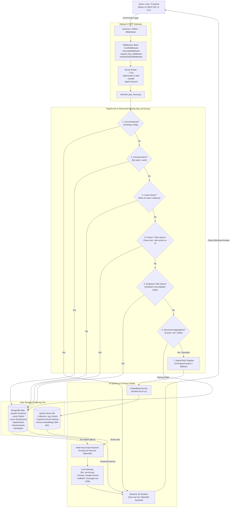
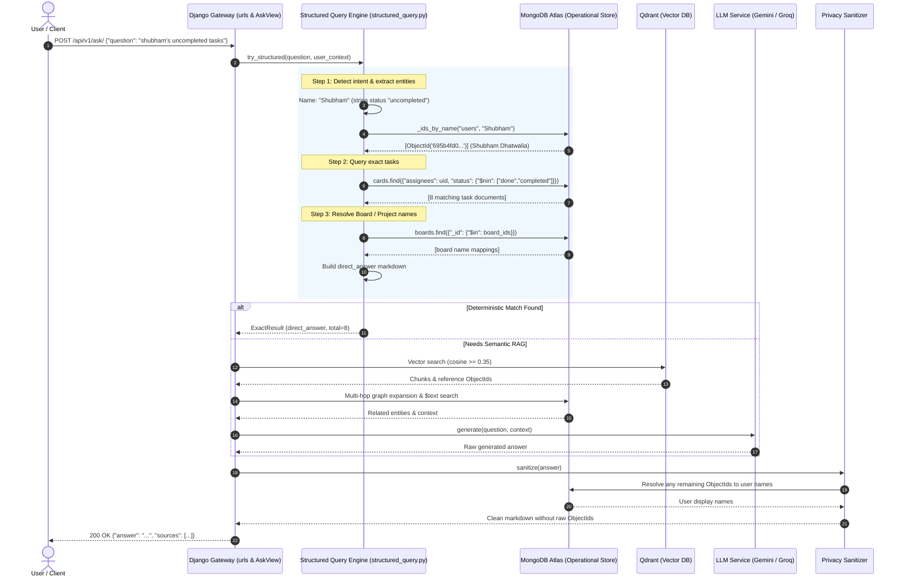
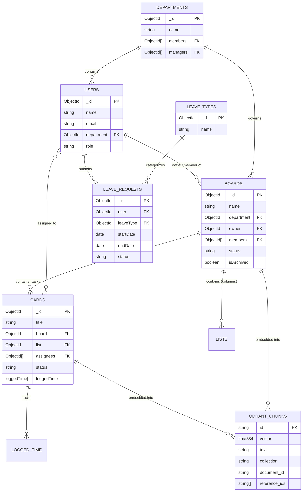

# Mongo RAG Pro: System Architecture & Component Wiring

This document provides a comprehensive blueprint of how the Mongo RAG Pro Chatbot functions, including architectural wiring, execution sequence, database relationships, and component interactions.

---

## 1. End-to-End Chatbot Execution & Wiring Diagram

The diagram below maps the complete path of an incoming query from the client, through authentication, routing, deterministic engines, vector retrieval, and LLM answer generation:

---

## 2. Request / Response Lifecycle Sequence Flow

---

## 3. Database Schema & Relational Wiring

The diagram below illustrates how data is related across collections in MongoDB and mirrored into Qdrant for semantic search:

---

## 4. Architectural Component Reference

### 1. Gateway & Routing (`config/urls.py`, `rag/urls.py`, `rag/api_views.py`)
- **`AskView` (`/api/v1/ask/`, `/ask/`)**: The primary API entry point for user chat questions. Accepts JSON payloads with session IDs, query strings, and optional workspace tokens.
- **`HealthView` (`/health/`, `/api/v1/health/`)**: Uptime and health check endpoint returning system diagnostics (MongoDB status, vector collection count, active LLM provider).
- **`request_log_middleware` (`rag/middleware.py`)**: Intercepts requests, measures response latencies, and automatically strips body bytes on `HEAD` requests to ensure RFC 9110 compliance.

### 2. Structured Query Engine (`rag/services/structured_query.py`)
- **Deterministic Accuracy**: Direct MongoDB queries bypass LLMs for mathematical, count, status, or date-sensitive operations.
- **Canonical Leave Engine**: Resolves employee leave requests against `leaverequests` and `leavetypes` with precise calendar filtering.
- **Team & Department Linkage**: Resolves full project hierarchies: `board -> department -> user roster`, active contributors, and task assignees.
- **Employee Task Resolver**: Extracts employee names and status modifiers (`uncompleted`, `pending`, `done`) and retrieves assigned cards.

### 3. Vector Search & Graph Expansion (`rag/services/vector_index.py`, `rag/services/rag_service.py`)
- **Qdrant Vector Store**: Dense vector matching with auto-healing payload indexes.
- **Reciprocal Rank Fusion (RRF)**: Merges dense vector semantic results with MongoDB sparse text search (`$text`).
- **Multi-Hop Graph Traversals**: Follows foreign keys (`board`, `assignees`, `department`) forward and reverse to assemble complete relational context.

### 4. LLM Service (`rag/services/llm_service.py`)
- **Multi-Provider Engine**:
  - Primary: Google Gemini (`gemini-3.5-flash-lite` via OpenAI-compatible endpoint).
  - Fallback: Groq (`gpt-oss-120b`).
- **Strict Anti-Hallucination Prompts**: Returns `NOT_FOUND_ANSWER` when evidence is missing.

### 5. Privacy & Sanitization Shield (`rag/services/structured_query.py`)
- **Zero Hex ID Policy**: Raw 24-character ObjectIds (`68f0d3a8...`) are matched against `users` and replaced with human names (e.g. `Vishal Sharma`). Any unmapped IDs are removed before returning to the client.
